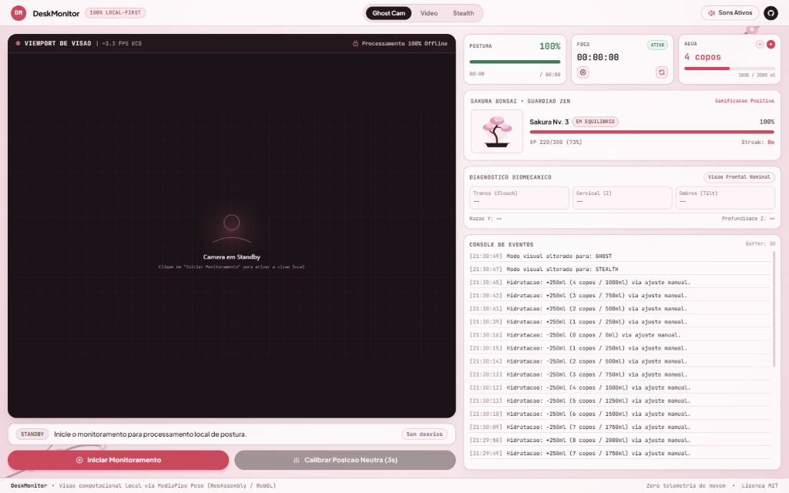

# DeskMonitor

Monitor de postura, hidratação e foco que roda direto no navegador usando a webcam local e o MediaPipe Pose. Nenhum frame sai da sua máquina — todo o processamento acontece localmente em WebAssembly/WebGL.

**Acesse online:** https://deskmonitor.guimevn.workers.dev/



## O que ele faz

- **Postura em tempo real:** calibra sua posição neutra em 3 segundos e acompanha inclinação do tronco (*slouching*), avanço do pescoço (*nerd neck*) e desnivelamento dos ombros. Só alerta depois de 8 segundos contínuos de desvio para evitar falsos positivos.
- **Modos de privacidade:** escolha entre *Ghost* (vídeo suavizado + wireframe), *Video* (câmera direta com overlay) ou *Stealth* (apenas o wireframe, sem exibir vídeo).
- **Hidratação:** reconhece o gesto de levar a mão/copo à boca para somar +250ml automaticamente, além dos botões manuais `+` e `-`.
- **Anti-doomscrolling:** avisa quando você fica olhando para baixo por mais de 15 segundos seguidos.
- **Timer de foco com auto-pause:** pausa sozinho se você sair da cadeira por mais de 30 segundos e retoma quando você volta.
- **Sakura Bonsai:** um bonsai em SVG que cresce, ganha XP e sobe de nível conforme você mantém boa postura e hidratação. O progresso fica salvo no `localStorage`.

## Como rodar localmente

O projeto é estático (HTML, CSS e ES Modules) e não precisa de build. Para abrir no navegador, sirva a pasta raiz em `localhost` (a API `getUserMedia` exige `http://localhost` ou `https://`):

```bash
# Com Node.js
npx serve .

# Ou com Python
python -m http.server 8000
```

Depois, abra o endereço exibido no terminal (por exemplo, `http://localhost:3000` no `serve` ou `http://localhost:8000` no Python).

## Testes

Os testes de lógica (postura, hidratação, doomscrolling, foco e bonsai) rodam direto no Node.js:

```bash
node tests/verify.mjs
```

## Licença

[MIT](LICENSE)
